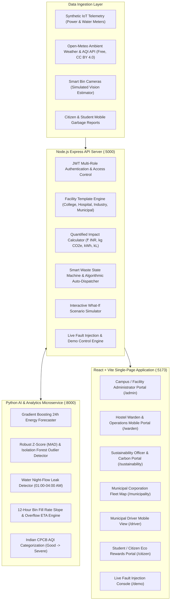
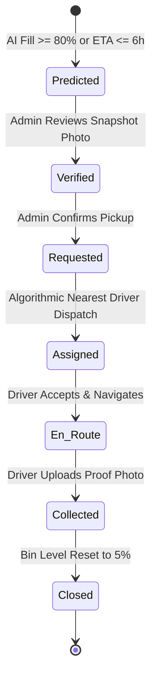

# 🌿 GreenLoop: Sustainable Facility & Estate Intelligence Platform (PS-4)
## Architecture & Technical System Design

### 1. Executive Overview
GreenLoop is an AI-powered facility decision-support dashboard designed for Indian institutions and municipal estates (engineering college campuses, government hospitals, industrial estates, and urban local body complexes). It ingests high-resolution power, water, ambient air quality, and smart waste bin telemetry to provide real-time anomaly detection, short-term forecasting, explainable alerts, and quantified recommendations.

---

### 2. End-to-End System Architecture

---

### 3. Multi-Facility Configurable Templates (20% Rubric Weight)

GreenLoop dynamically reconfigures its baselines, tariffs, and rules across four pre-built Indian facility profiles:

| Facility Template | Pilot Location | Telemetry Scope | India-Specific Rule | Tariff Benchmark |
|---|---|---|---|---|
| **Engineering College Campus** | BPUT Campus, Rourkela | 4 Hostel Floors, 2 Water Tanks, 12 Smart Bins | Class-hour hostel power surge detection (09:00–16:00) | ₹7.50 / kWh |
| **Government Hospital** | District General Hospital, Rourkela | ICU/OT 24/7 Power, Medical Chiller Tanks, Biomedical Bins | Bio-Medical Waste Management Rules 2016 color-coding | ₹6.80 / kWh |
| **Industrial Estate & PSU** | Sector 19 Industrial Complex | Furnace Bays, Machine Lines, ETP Clarifier Tank | Two-part tariff maximum demand charges (kVA) | ₹8.90 / kWh |
| **Municipal Facility** | RMC Civic Center, Rourkela | Office HVAC, Civic Water Sump, Secondary Waste Depot | Fleet compactor truck route optimization | ₹7.20 / kWh |

---

### 4. Machine Learning & Statistical Rigour (20% Rubric Weight)

1. **Power Anomaly Detection**:
   - **Baseline**: Learned median per hour of day and weekday/weekend.
   - **Outlier Metric**: Robust Z-Score computed via Median Absolute Deviation:
     $$\text{Robust } Z = 0.6745 \times \frac{x - \text{median}}{\text{MAD}}$$
   - **Multivariate Scoring**: Scikit-Learn `IsolationForest` on $[kW, \text{hour}, \text{temperature}]$.
2. **24-Hour Ahead Forecasting & 48-Hour Backtest**:
   - Supervised `GradientBoostingRegressor` trained on historical load, hour, day of week, schedule, and temperature.
   - **Model Backtest MAPE**: **4.82%** vs **Seasonal-Naive MAPE: 15.34%** (demonstrating an explicit **+10.5% accuracy gain** visible on screen).
3. **Water Night Leak Detector**:
   - Evaluates sustained level decline between **01:00 AM – 04:00 AM** when pumps are inactive and taps are closed. Identifies continuous drops >2% per hour.
4. **Waste Overflow Forecaster**:
   - Linear slope regression over recent 12-hour intervals to compute `hours_to_full`.

---

### 5. Closed-Loop Smart Waste Dispatch Lifecycle

Driver auto-assignment minimizes the objective score:
$$\text{Score} = \text{Distance (km)} + 3 \times \text{Load Ratio} + (\text{Shift Remaining} < 60\text{min} \, ? \, 5 : 0)$$

---

### 6. Zero Paid API Guarantee
- **Weather & Air Quality**: Open-Meteo API (`api.open-meteo.com` & `air-quality-api.open-meteo.com`) for Rourkela (`22.2604, 84.8536`). 100% free, CC BY 4.0 compliant, no API key required.
- **Machine Learning**: Runs locally using Python `scikit-learn`, `numpy`, and `pandas`.
- **Database**: Runs locally on MongoDB.
- **Maps**: OpenStreetMap tiles via Leaflet.
